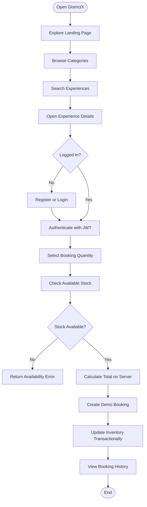
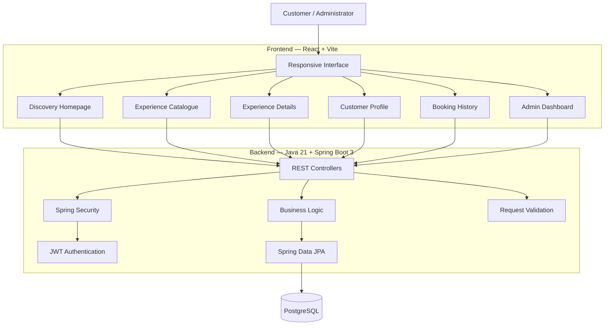
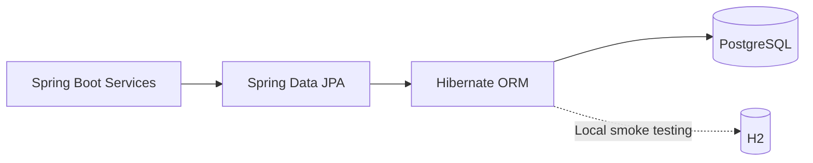
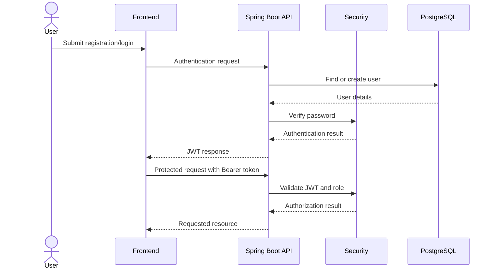
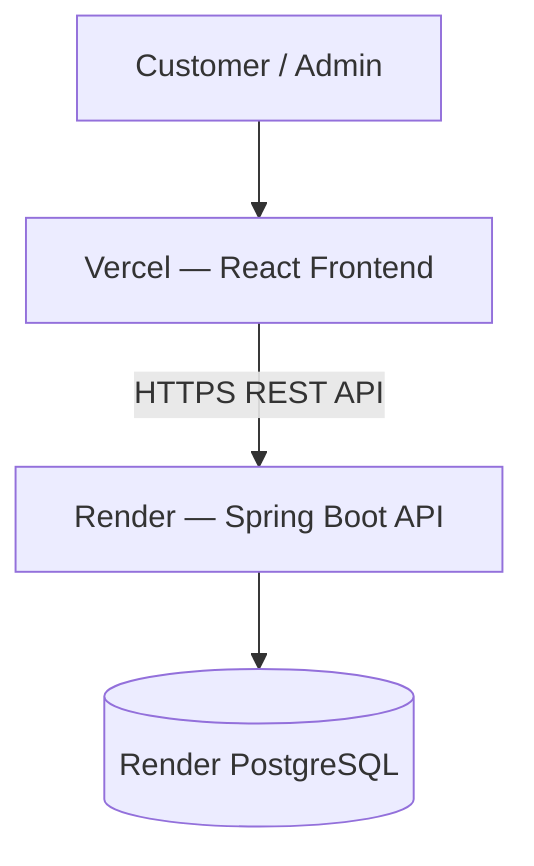

# 🎟️ DistrictX — Discover Your City

<p align="center">
  <strong>One platform. Endless experiences. Discover, explore, and book what your city has to offer.</strong>
  <br/>
  An independently built, District-inspired discovery and booking platform.
</p>

<p align="center">
  
  
  
  
  
  
</p>

<p align="center">
  <strong>Discover Experiences • Book Activities • Explore Your City</strong>
</p>

---

## 📖 Project Overview

**DistrictX** is a full-stack city discovery and experience-booking platform built using React, Java 21, Spring Boot 3, and PostgreSQL.

Inspired by modern experience-discovery platforms, DistrictX brings multiple categories of activities into one unified application.

Users can discover events, movies, dining experiences, and sports activities, explore individual listings, and create bookings through a responsive interface.

The platform also provides an administrator dashboard for managing catalogue experiences and monitoring booking activity.

DistrictX is an independently implemented project with its own branding, application architecture, and development direction. It does not use District's source code, private APIs, branding assets, or proprietary data.

### 🎯 Project Objectives

- Build a unified city discovery and booking platform.
- Provide category-based experience discovery.
- Implement secure user registration and authentication.
- Develop a complete customer booking workflow.
- Manage inventory through backend validation.
- Create an administrator dashboard.
- Integrate React with Spring Boot REST APIs.
- Use PostgreSQL for persistent application data.
- Establish a foundation for real payment and supplier integrations.

---

## ✨ Key Features

### 👤 Customer Features

| Feature | Description |
|---|---|
| Landing Page | Responsive homepage for discovering experiences |
| Discovery Catalogue | Browse available experiences |
| Category Browsing | Explore Events, Movies, Dining, and Sports |
| Search | Search catalogue entries using text |
| Experience Details | View individual experience information |
| Registration | Create a customer account |
| Authentication | Login using email and password |
| Password Security | BCrypt password hashing |
| JWT Sessions | Token-based authentication |
| Booking Creation | Create authenticated bookings |
| Inventory Validation | Check stock before booking |
| Server-side Pricing | Calculate booking totals on the backend |
| Booking History | View personal bookings |
| Customer Profile | Access customer profile information |
| Wishlist | Save experiences locally in the browser |

### 🛠️ Administrator Features

| Feature | Description |
|---|---|
| Admin Login | Authenticate administrator accounts |
| Protected API | Restrict administrative operations |
| Overview Dashboard | View platform metrics |
| User Statistics | Monitor registered users |
| Catalogue Statistics | View catalogue entries |
| Booking Statistics | Monitor bookings |
| Gross Booking Value | View recorded booking value |
| Create Experiences | Add catalogue listings |
| Update Experiences | Modify existing listings |
| Soft Delete | Remove listings without treating deletion as a permanent database operation |
| Role-Based Access | Restrict admin APIs to authorized administrators |

### ⚙️ Technical Features

- Java 21 backend.
- Spring Boot 3 REST API.
- React and Vite frontend.
- PostgreSQL persistence.
- Spring Data JPA.
- BCrypt password hashing.
- JWT bearer authentication.
- Transactional booking stock decrement.
- API request validation.
- H2 database support for local smoke testing.
- Docker Compose PostgreSQL setup.
- Render backend deployment.
- Vercel frontend deployment.

---

## 🏙️ Experience Categories

DistrictX currently provides a shared experience catalogue covering four categories.

<grid columns={2} gap={3}>
  <grid-item>
    <box radius="lg" clip>
      <AsyncImage query="live music concert crowd stage colorful lights" aspectRatio="16:9" width="100%"/>
    </box>
    **🎵 Events**

    <text color="secondary" size="sm">Discover concerts, entertainment, and live experiences.</text>
  </grid-item>
  <grid-item>
    <box radius="lg" clip>
      <AsyncImage query="cinema movie theater auditorium red seats screen" aspectRatio="16:9" width="100%"/>
    </box>
    **🎬 Movies**

    <text color="secondary" size="sm">Explore movie experiences and cinema listings.</text>
  </grid-item>
  <grid-item>
    <box radius="lg" clip>
      <AsyncImage query="modern restaurant fine dining table interior" aspectRatio="16:9" width="100%"/>
    </box>
    **🍽️ Dining**

    <text color="secondary" size="sm">Discover restaurants and dining experiences.</text>
  </grid-item>
  <grid-item>
    <box radius="lg" clip>
      <AsyncImage query="indoor sports activity badminton court people playing" aspectRatio="16:9" width="100%"/>
    </box>
    **🏏 Sports**

    <text color="secondary" size="sm">Explore sports and recreational activities.</text>
  </grid-item>
</grid>

*These images illustrate the platform's categories and are not claims about specific live listings.*

---

## 🔄 Customer Booking Workflow

The current application supports a general experience-booking workflow.



### Booking capabilities

- Authenticated customers can create bookings.
- The backend checks available stock.
- Booking totals are calculated server-side.
- Inventory decrement runs inside a transaction.
- Customers can view their own booking history.

**Important:** The current booking endpoint creates a confirmed demo booking. It does not collect real payments.

---

## 🏗️ System Architecture

DistrictX follows a three-layer application architecture.



### Architecture Components

| Component | Technology | Responsibility |
|---|---|---|
| Frontend | React | User interface |
| Build Tool | Vite | Development and production builds |
| Backend | Spring Boot 3 | REST API and application services |
| Programming Language | Java 21 | Backend implementation |
| Security | Spring Security | API access control |
| Authentication | JWT | Bearer-token authentication |
| Password Security | BCrypt | Password hashing |
| ORM | Spring Data JPA | Database persistence |
| Database | PostgreSQL | Persistent application data |
| Smoke Testing | H2 | Alternative local test database |
| Local Infrastructure | Docker Compose | PostgreSQL startup |
| Backend Hosting | Render | API deployment |
| Frontend Hosting | Vercel | Frontend deployment |

---

## 📁 Project Structure

```text
DistrictX/
│
├── backend/
│   ├── pom.xml
│   │
│   └── src/
│       └── main/
│           ├── java/
│           │   └── com/
│           │       └── districtx/
│           │           ├── DistrictXApplication.java
│           │           ├── Domain.java
│           │           ├── Repositories.java
│           │           ├── SecurityConfig.java
│           │           └── ApiController.java
│           │
│           └── resources/
│               └── application.properties
│
├── frontend/
│   ├── package.json
│   ├── index.html
│   ├── .env.example
│   ├── vercel.json
│   │
│   └── src/
│       ├── main.jsx
│       ├── App.jsx
│       └── styles.css
│
├── docker-compose.yml
└── README.md
```

### Important backend files

| File | Responsibility |
|---|---|
| `DistrictXApplication.java` | Spring Boot application entry point |
| `Domain.java` | Domain model definitions |
| `Repositories.java` | Data access layer |
| `SecurityConfig.java` | Application security configuration |
| `ApiController.java` | REST API endpoints |
| `application.properties` | Backend application configuration |

### Important frontend files

| File | Responsibility |
|---|---|
| `main.jsx` | React application entry point |
| `App.jsx` | Main application interface |
| `styles.css` | Application styling |
| `package.json` | Frontend dependencies and scripts |
| `vercel.json` | Vercel SPA routing configuration |

---

## 🗄️ Database and Persistence

DistrictX uses PostgreSQL with Spring Data JPA.

The database supports the core application entities:

- Users and roles.
- Experience catalogue entries.
- Customer bookings.
- Booking-related inventory information.

The exact entity attributes, table names, and relationships should be taken from the current backend domain definitions rather than assumed from the high-level project description.

### Database interaction



### Booking inventory handling

The booking process performs stock validation and inventory decrement transactionally.

This provides a foundation for safer booking operations. However, a production booking system also needs reservation expiry, concurrency handling, idempotency, and payment reconciliation.

---

## 🔐 Authentication and Authorization

DistrictX implements authentication using JWT and BCrypt.

### Authentication workflow



### Security features

- BCrypt password hashing.
- JWT bearer authentication.
- Protected customer booking endpoints.
- Protected administrator APIs.
- Role-based API authorization.
- Server-side request validation.

### Demo administrator account

<badge color="warning">Development credentials only</badge>

| Field | Value |
|---|---|
| Email | `admin@districtx.local` |
| Password | `Admin@12345` |

Change the demo password and configure a strong `JWT_SECRET` before any shared or public deployment.

---

## 🌐 REST API Reference

API base URL:

```text
http://localhost:8080/api
```

| Method | Endpoint | Access | Description |
|---|---|---|---|
| `POST` | `/auth/register` | Public | Register a customer |
| `POST` | `/auth/login` | Public | Authenticate and receive JWT |
| `GET` | `/experiences` | Public | Browse and filter experiences |
| `GET` | `/experiences/{id}` | Public | Retrieve experience details |
| `POST` | `/bookings` | Customer | Create a demo booking |
| `GET` | `/bookings/me` | Customer | Retrieve current user's bookings |
| `GET` | `/admin/overview` | Admin | Retrieve dashboard metrics |
| `POST` | `/admin/experiences` | Admin | Create a catalogue listing |
| `PUT` | `/admin/experiences/{id}` | Admin | Update a catalogue listing |
| `DELETE` | `/admin/experiences/{id}` | Admin | Soft-delete a catalogue listing |

### Query parameters

Browse by category:

```http
GET /api/experiences?category=Events
```

Search the catalogue:

```http
GET /api/experiences?q=comedy
```

### Authentication header

Protected requests use a bearer token:

```http
Authorization: Bearer YOUR_JWT_TOKEN
```

*Refer to the backend implementation for exact request bodies, response formats, validation rules, and error codes.*

---

## 🚀 Getting Started

### Prerequisites

| Software | Version |
|---|---|
| Java | 21 |
| Maven | 3.9+ |
| Node.js | 20+ |
| npm | Compatible with Node.js |
| PostgreSQL | 15+ |
| Docker | Required for the supplied database startup workflow |

### 1. Clone the repository

```bash
git clone <YOUR_GITHUB_REPOSITORY_URL>
cd DistrictX
```

### 2. Start PostgreSQL

From the project root:

```bash
docker compose up -d db
```

This starts the database service defined in `docker-compose.yml`.

### 3. Start the backend

Open a terminal:

```bash
cd backend
mvn spring-boot:run
```

Backend API:

```text
http://localhost:8080/api
```

The application creates the required tables and seeds demo experiences on first startup.

### 4. Configure the frontend

Open another terminal:

```bash
cd frontend
```

Copy the example environment file:

```bash
cp .env.example .env
```

Configure the local API URL:

```env
VITE_API_URL=http://localhost:8080/api
```

Install frontend dependencies:

```bash
npm install
```

### 5. Start the frontend

```bash
npm run dev
```

### 6. Open DistrictX

Visit:

```text
http://localhost:5173
```

You can now explore the catalogue, register as a customer, and try the demo booking workflow.

---

## ⚙️ Environment Variables

### Backend Configuration

| Variable | Default | Purpose |
|---|---|---|
| `PORT` | `8080` | HTTP server port |
| `DATABASE_URL` | Local PostgreSQL JDBC URL | Database connection |
| `DB_USERNAME` | `postgres` | Database username |
| `DB_PASSWORD` | `postgres` | Database password |
| `JWT_SECRET` | Local development value | JWT HMAC signing secret |
| `FRONTEND_URL` | `http://localhost:5173` | Frontend origin reference |

### Frontend Configuration

| Variable | Example | Purpose |
|---|---|---|
| `VITE_API_URL` | `https://your-api.onrender.com/api` | Backend API base URL |

### Production configuration notes

- Use a strong, randomly generated JWT secret of at least 32 characters.
- Never commit database credentials or secrets to GitHub.
- Use Render's internal PostgreSQL connection details for backend-to-database communication.
- Ensure the database URL uses the JDBC scheme `jdbc:postgresql://`.
- Configure CORS to allow only the deployed frontend origin.
- Do not expose private backend credentials through frontend environment variables.

---

## ☁️ Deployment Guide

DistrictX uses a split deployment architecture:

| Component | Platform |
|---|---|
| Frontend | Vercel |
| Backend | Render |
| Database | Render PostgreSQL |

### Deployment architecture



### 1. Deploy PostgreSQL on Render

1. Open Render.
2. Create a PostgreSQL database.
3. Copy the internal connection information.
4. Configure the database credentials in the backend service.

### 2. Deploy the Spring Boot backend

Create a Render Web Service connected to your GitHub repository.

| Setting | Value |
|---|---|
| Root Directory | `backend` |
| Build Command | `mvn clean package -DskipTests` |
| Start Command | `java -jar target/districtx-api-1.0.0.jar` |

Configure the environment variables:

```text
DATABASE_URL=jdbc:postgresql://YOUR_DATABASE_HOST:5432/YOUR_DATABASE
DB_USERNAME=YOUR_DATABASE_USERNAME
DB_PASSWORD=YOUR_DATABASE_PASSWORD
JWT_SECRET=YOUR_STRONG_RANDOM_SECRET
FRONTEND_URL=https://YOUR-VERCEL-DOMAIN
```

Also configure any required administrator bootstrap credentials according to the application's actual configuration.

Deploy the service and copy its public URL.

### 3. Deploy the React frontend on Vercel

1. Open Vercel.
2. Import the GitHub repository.
3. Set the root directory to `frontend`.
4. Configure the build settings.

| Setting | Value |
|---|---|
| Root Directory | `frontend` |
| Build Command | `npm run build` |
| Output Directory | `dist` |

Add:

```env
VITE_API_URL=https://YOUR-RENDER-URL.onrender.com/api
```

Deploy the frontend.

The included `vercel.json` handles single-page application routing.

### 4. Configure CORS

Set the backend's frontend origin configuration to the exact deployed Vercel origin.

Example:

```text
https://your-districtx-project.vercel.app
```

Avoid broad wildcard origins in production.

### 5. Verify the deployment

Test the following after deployment:

- Landing page loads.
- Catalogue displays seeded experiences.
- Category browsing works.
- Search works.
- Experience details open.
- Customer registration works.
- Customer login returns a usable JWT.
- Booking creation validates inventory.
- Booking history displays the customer's records.
- Admin login works.
- Admin catalogue operations are protected.

---

## ⚠️ Important Integration Boundaries

DistrictX is a runnable full-stack foundation, not a live District supplier network.

### What is currently implemented

- Shared experience catalogue.
- Customer registration and login.
- JWT authentication.
- Customer booking creation.
- Inventory checks.
- Server-side booking total calculation.
- Transactional stock decrement.
- Booking history.
- Administrator dashboard and catalogue management.

### What requires additional integration

| Feature | Current Status |
|---|---|
| Real payment processing | Not implemented |
| Razorpay order creation | Future integration |
| Payment verification | Future integration |
| Payment refunds | Future integration |
| Live movie showtimes | Requires authorized provider |
| Cinema seat maps | Future category-specific module |
| Restaurant table inventory | Future category-specific module |
| Sports court calendars | Future category-specific module |
| Venue slot calendars | Future category-specific module |
| Maps and location services | Requires provider integration |
| Email/SMS notifications | Future integration |
| QR ticket issuance and scanning | Future integration |
| Organizer settlement | Future integration |
| Third-party ticket suppliers | Requires authorized provider access |

The seeded catalogue is demo content. Live inventory, availability, and supplier integrations must not be inferred from it.

---

## 💳 Payment Integration and Safety

<badge color="danger">Demo bookings — no real payments</badge>

The current booking endpoint creates a confirmed demo booking. It does not charge a card or verify a real payment.

Before accepting real money, implement:

1. Razorpay order creation on the backend.
2. Server-side payment signature verification.
3. Webhook verification and reconciliation.
4. Booking confirmation only after verified payment.
5. Payment idempotency.
6. Cancellation and refund workflows.
7. Secure payment failure and retry handling.

Never trust a frontend success message as proof of payment.

---

## 🔒 Production Hardening Checklist

Before public commercial launch, consider completing the following:

- [ ] Replace demo administrator credentials.
- [ ] Implement a secure administrator bootstrap process.
- [ ] Add Razorpay payment integration.
- [ ] Implement payment signature verification and webhooks.
- [ ] Add booking holds with expiration.
- [ ] Implement safe concurrent inventory reservation.
- [ ] Add booking idempotency.
- [ ] Implement cancellation and refund policies.
- [ ] Add category-specific seat, table, and slot inventory.
- [ ] Add QR ticket generation and server-side scanning validation.
- [ ] Add organizer accounts and ownership checks.
- [ ] Implement organizer payout and settlement logic.
- [ ] Add email and SMS notifications.
- [ ] Add pagination and API rate limiting.
- [ ] Implement structured application logs and audit trails.
- [ ] Add automated unit, integration, and end-to-end tests.
- [ ] Configure database backups.
- [ ] Add monitoring and error reporting.
- [ ] Review accessibility and mobile usability.
- [ ] Add privacy policy, terms, and supplier agreements.

---

## 🔮 Future Roadmap

| Module | Planned Capabilities |
|---|---|
| Cinema Booking | Showtimes, seat maps, and seat locking |
| Dining Reservations | Restaurant tables and time-slot availability |
| Sports Booking | Court calendars and activity reservations |
| Events | Organizer listings, ticket categories, and QR entry |
| Payments | Razorpay integration and refunds |
| Notifications | Email and SMS booking updates |
| Maps | Venue discovery and location-based search |
| Recommendations | Personalized experience discovery |
| Organizer Portal | Listing management, bookings, and settlements |
| Analytics | Sales, inventory, and booking reports |

These are planned extensions, not features represented as currently operational.

---

## 📚 Learning Outcomes

This project demonstrates practical experience with:

- Java 21 development.
- Spring Boot REST API architecture.
- React and Vite frontend development.
- PostgreSQL database integration.
- Spring Data JPA and ORM-based persistence.
- JWT authentication and authorization.
- BCrypt password hashing.
- Role-based access control.
- Transactional inventory management.
- Backend validation and business logic.
- Docker Compose.
- API integration between React and Spring Boot.
- Full-stack deployment using Render and Vercel.
- Production architecture planning and integration boundaries.

---

## 📜 License and Project Independence

DistrictX is an independently developed project with its own brand identity and implementation.

It is inspired by the general concept of discovering and booking local experiences. It does not use District's proprietary source code, private APIs, branding assets, or proprietary data.

Before public launch, add an appropriate open-source or commercial license, privacy policy, terms of service, original brand assets, and required supplier agreements.

---

## 👨‍💻 Developer

**Developed by Lakshya Kansal**

DistrictX is a full-stack discovery and booking platform built to demonstrate modern frontend engineering, Java backend development, database management, authentication, and transactional booking workflows.

<p align="center">
  <strong>✨ DistrictX — Discover Your City.</strong>
  <br/>
  <em>Find experiences. Make plans. Create memories.</em>
</p>
